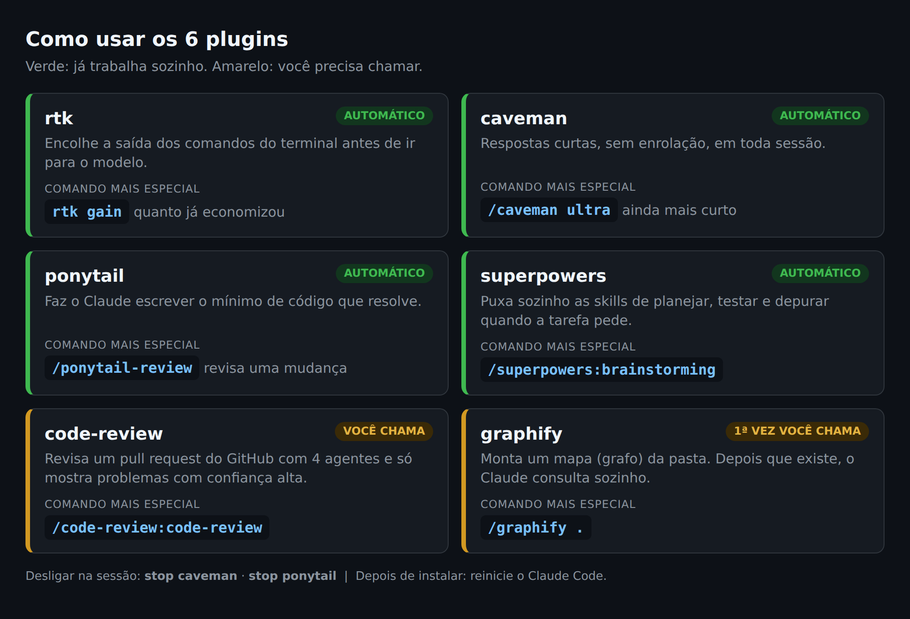
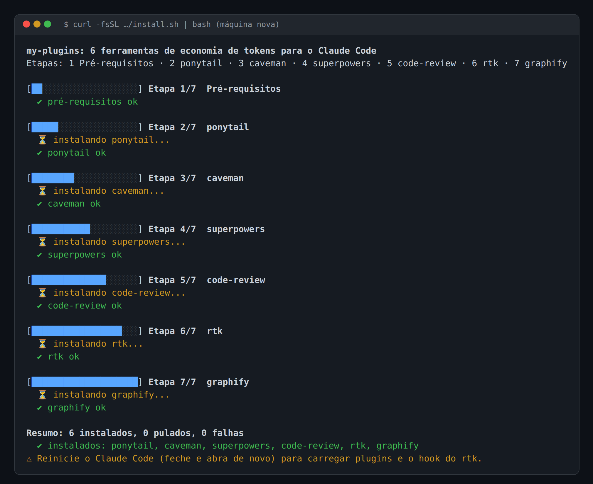
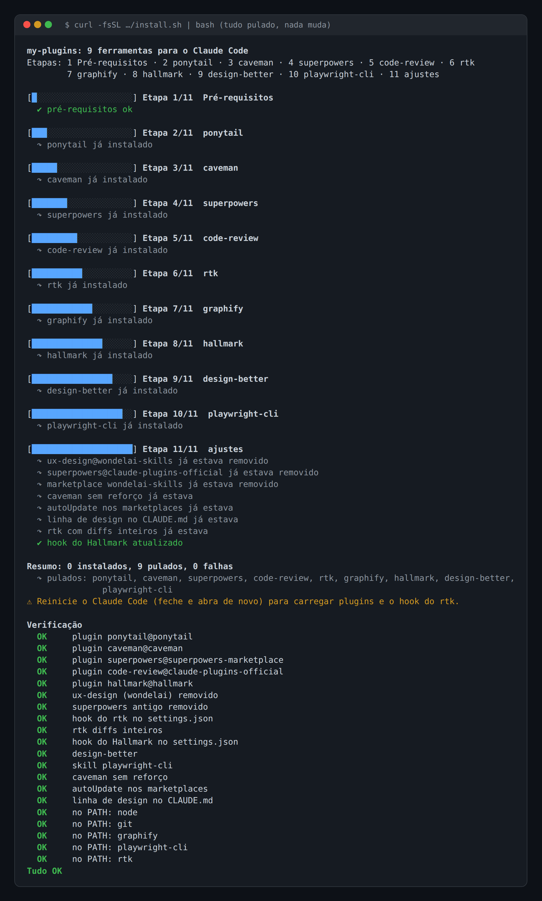
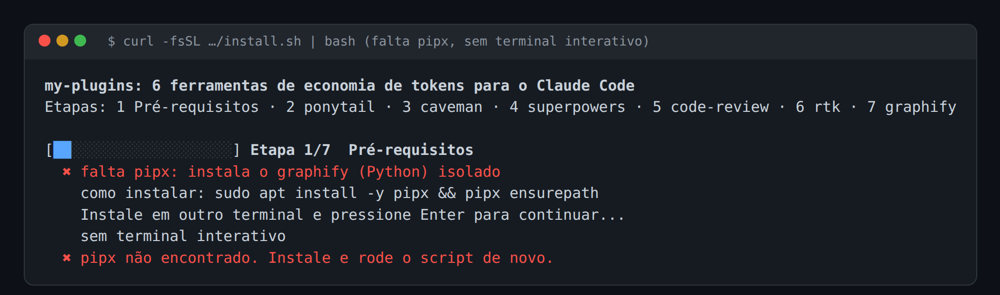

# my-plugins


Um comando instala 6 ferramentas que economizam tokens no Claude Code.
Pula o que já está instalado e desliga a telemetria do rtk.

## Como usar



**Já trabalham sozinhos** (não precisa fazer nada):
* **rtk**: comando mais especial `rtk gain` (no terminal), que mostra quanto já economizou.
* **caveman**: comando mais especial `/caveman ultra`, que deixa as respostas ainda mais curtas. Para desligar, escreva `stop caveman`.
* **ponytail**: comando mais especial `/ponytail-review`, que revisa uma mudança. Para desligar, escreva `stop ponytail`.
* **superpowers**: puxa sozinho as skills de planejar, testar e depurar. Comando mais especial `/superpowers:brainstorming`, para planejar uma ideia antes de codar.

**Você precisa chamar:**
* **code-review**: comando mais especial `/code-review:code-review`.
  Use dentro do repo, na branch de um pull request aberto no GitHub (precisa do `gh` logado).
  Com `--comment` no fim, a revisão vira comentário no PR.
  Atenção: `/code-review` sozinho é o revisor que já vem no Claude Code (revisa o diff local), não este plugin.
* **graphify**: comando mais especial `/graphify .`, que monta o mapa da pasta atual.
  Só precisa chamar na primeira vez. Depois disso, o Claude consulta o mapa sozinho.

## Plugins

**ponytail**: faz o agente agir como um dev sênior preguiçoso, que escreve o mínimo de código que resolve.
[DietrichGebert/ponytail](https://github.com/DietrichGebert/ponytail)

**caveman**: faz o agente responder curto, estilo "homem das cavernas", sem perder o conteúdo técnico.
[JuliusBrussee/caveman](https://github.com/JuliusBrussee/caveman)

**superpowers**: conjunto de skills com um método de desenvolvimento (planejar, testar, revisar).
[obra/superpowers](https://github.com/obra/superpowers)

**code-review**: comando `/code-review` que revisa um PR com vários agentes em paralelo e filtra falsos positivos.
[anthropics/claude-plugins-official](https://github.com/anthropics/claude-plugins-official/tree/main/plugins/code-review)

**rtk**: proxy de linha de comando que comprime a saída de comandos comuns antes de chegar ao modelo.
[rtk-ai/rtk](https://github.com/rtk-ai/rtk)

**graphify**: skill `/graphify` que transforma uma pasta (código, docs, PDFs) num grafo de conhecimento consultável.
[Graphify-Labs/graphify](https://github.com/Graphify-Labs/graphify) (pacote PyPI `graphifyy`)

## Resumo

| Nome | O que faz | Como instala / origem |
|---|---|---|
| ponytail | código mínimo | plugin `ponytail@ponytail` (marketplace DietrichGebert/ponytail) |
| caveman | respostas curtas | plugin `caveman@caveman` (marketplace JuliusBrussee/caveman) |
| superpowers | método de desenvolvimento | plugin `superpowers@claude-plugins-official` |
| code-review | revisão de PR | plugin `code-review@claude-plugins-official` |
| rtk | comprime saída de comandos | Ubuntu: script oficial; Windows: `winget` (`rtk-ai.rtk`) |
| graphify | grafo de conhecimento | Ubuntu: `pipx install graphifyy`; Windows: `uv tool install graphifyy` |

## Instalação

**Ubuntu**
```bash
curl -fsSL https://raw.githubusercontent.com/luiz-nast/my-plugins/main/install.sh | bash
```

**Windows (PowerShell)**
```powershell
irm https://raw.githubusercontent.com/luiz-nast/my-plugins/main/install.ps1 | iex
```

### Requisitos

| Ubuntu | Windows |
|---|---|
| Claude Code (`claude`) | Claude Code (`claude`) |
| `curl` | `winget` (App Installer, Microsoft Store) |
| `git` | `uv` (`winget install -e --id astral-sh.uv`) |
| `pipx` (`sudo apt install -y pipx && pipx ensurepath`) | |

Se faltar algo, o script mostra como instalar e espera você apertar Enter.
Se ainda faltar, ele para sem mudar nada.

### Etapas

1. **Pré-requisitos**: confere os requisitos acima (no Windows, pergunta sobre o ponytail).
2. **ponytail**
3. **caveman**
4. **superpowers**
5. **code-review**
6. **rtk**: instala, faz backup do `settings.json`, liga o hook global e desliga a telemetria.
7. **graphify**: instala e roda `graphify install`.

Cada etapa mostra uma barra de progresso e um status: `✔` ok, `↷` já instalado/pulado, `✖` erro.
Uma falha não interrompe as outras etapas. No fim aparece um resumo.

## Como fica

Prints reais do `install.sh` no Ubuntu.

**Máquina nova** (a saída de cada instalador foi omitida, ficam só as linhas do script):



**Rodando de novo** (pula o que já está instalado):



**Falta um pré-requisito** (explica, espera o Enter e para sem mudar nada):



O `install.ps1` mostra as mesmas etapas e status no Windows; ainda não há print dele.

## O que muda na máquina

- `~/.claude/settings.json`: hook global `PreToolUse` do rtk.
- `~/.claude/settings.json.bak-AAAAMMDD-HHMMSS`: backup feito logo antes do `rtk init`.
- `~/.claude/RTK.md` e a linha `@RTK.md` no `~/.claude/CLAUDE.md`.
- `~/.claude/skills/graphify/` e um bloco do graphify no `~/.claude/CLAUDE.md`.
- `~/.claude/plugins/`: plugins e marketplaces.
- Binários: Ubuntu em `~/.local/bin` (rtk; graphify via pipx). Windows: links do winget e `%USERPROFILE%\.local\bin`.
- Telemetria do rtk desligada (`rtk telemetry disable`).

No Windows, `~` é `%USERPROFILE%`.

## Desinstalar

**Plugins** (Ubuntu e Windows):
```bash
claude plugin uninstall ponytail@ponytail
claude plugin uninstall caveman@caveman
claude plugin uninstall superpowers@claude-plugins-official
claude plugin uninstall code-review@claude-plugins-official
claude plugin marketplace remove ponytail
claude plugin marketplace remove caveman
```
Opcional: `claude plugin marketplace remove claude-plugins-official`.
Cuidado: outros plugins seus podem usar esse marketplace.

**rtk** (opcional antes: `rtk telemetry forget`):
```bash
# Ubuntu
rtk init -g --uninstall
rm -f "$(command -v rtk)"
```
```powershell
# Windows
rtk init -g --uninstall
winget uninstall -e --id rtk-ai.rtk
```

**graphify**:
```bash
# Ubuntu
graphify uninstall
pipx uninstall graphifyy
```
```powershell
# Windows
graphify uninstall
uv tool uninstall graphifyy
```

Opcional: restaurar o backup `settings.json.bak-*` por cima do `settings.json`.
Isso descarta qualquer mudança feita no `settings.json` depois do backup.

## Avisos

- **ponytail no Windows**: tem bug conhecido, trava cada mensagem por alguns segundos.
  Por isso o `install.ps1` pergunta antes, e o padrão é **N** (não instala).
  Sem terminal interativo, ele pula o ponytail.
  Para instalar depois, manualmente:
  ```powershell
  claude plugin install ponytail@ponytail
  ```
- **Símbolos como quadrados** (`✔ ✖ ↷ ⏳ █`): o console antigo do Windows (conhost) não desenha esses caracteres. Use o Windows Terminal.
- **Reinicie o Claude Code** (feche e abra de novo) depois de instalar, para carregar os plugins e o hook do rtk. No Windows, reabra também o terminal.

## Status

- **Ubuntu**: testado.
- **Windows**: a versão anterior foi testada e funcionou; o novo `install.ps1` ainda não foi testado. Testes pendentes.
