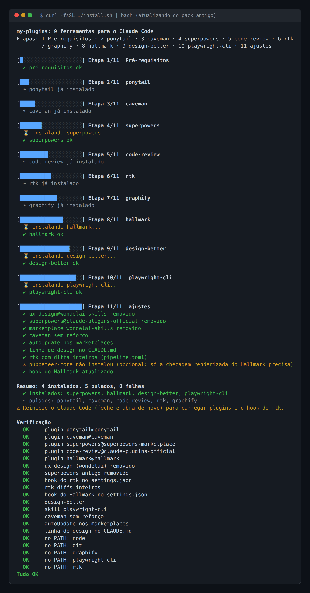
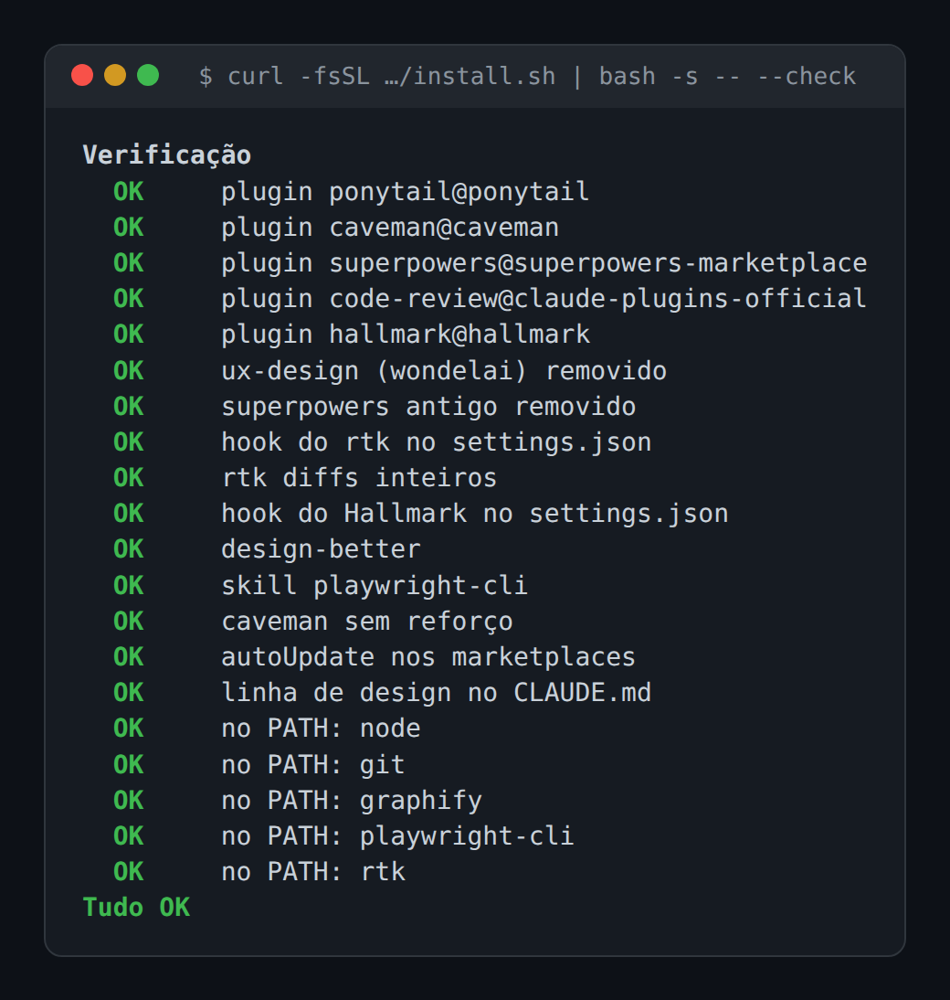

# my-plugins


Um comando instala 9 ferramentas para o Claude Code.
Pula o que já está instalado.

**Nem todas economizam tokens.**
rtk, caveman, ponytail e playwright-cli economizam.
superpowers, code-review, hallmark e design-better melhoram a qualidade e o design (superpowers e code-review até gastam mais).
O graphify depende: ajuda em repositório grande.

## Como usar


**Ligam sozinhos** (não precisa fazer nada):
* **ponytail**: hook ao abrir a sessão. Comando mais especial `/ponytail-review`, que revisa uma mudança. Para desligar, escreva `stop ponytail`.
* **caveman**: hook ao abrir a sessão. Comando mais especial `/caveman ultra`, que deixa as respostas ainda mais curtas. O script desliga o reforço a cada prompt (`reinforce: false`). Para desligar, escreva `stop caveman`.
* **superpowers**: hook e skills de planejar, testar e depurar. Comando mais especial `/superpowers:brainstorming`, para planejar uma ideia antes de codar.
* **rtk**: hook que comprime a saída dos comandos do terminal. Comando mais especial `rtk gain` (no terminal), que mostra quanto já economizou (no uso real: ~900 mil tokens, 25%). `git diff`, `git show` e `gh pr diff` passam inteiros.
* **hallmark**: o único líder de design visual (temas prontos). Dispara sozinho quando você pede algo novo. Um hook de edição avisa contraste, foco e layout no celular nos arquivos do Hallmark. Comando mais especial `/hallmark:hallmark <pedido>` (e `/hallmark:hallmark audit <pasta>`).
* **design-better**: UX, com 50 heurísticas numeradas e as Laws of UX. O Claude puxa sozinho quando o assunto é tela. Comando mais especial `/design-better`. A linha de design no `CLAUDE.md` global divide o trabalho: Hallmark faz o visual, design-better cuida da UX.
* **playwright-cli**: abre o navegador e confere a tela de verdade. O Claude puxa sozinho quando precisa ver uma página. Gasta menos token que o Playwright MCP. Comando mais especial `playwright-cli open <url>`.

**O Claude chama quando faz sentido (ou você chama):**
* **code-review**: comando mais especial `/code-review:code-review`.
  Use dentro do repo, na branch de um pull request aberto no GitHub (precisa do `gh` logado).
  Com `--comment` no fim, a revisão vira comentário no PR.
  Atenção: `/code-review` sozinho é o revisor que já vem no Claude Code (revisa o diff local), não este plugin.

**Uma vez por projeto:**
* **graphify**: comando mais especial `/graphify .`, que monta o mapa da pasta atual.
  O Claude só consulta o mapa sozinho depois de rodar `graphify claude install` uma vez em cada projeto (grava um bloco no `CLAUDE.md` do projeto).

## O pack

| Item | O que faz | Origem / instalação |
|---|---|---|
| ponytail | código mínimo | plugin `ponytail@ponytail` (marketplace DietrichGebert/ponytail) |
| caveman | respostas curtas | plugin `caveman@caveman` (marketplace JuliusBrussee/caveman) |
| superpowers | método: planejar, testar, depurar | plugin `superpowers@superpowers-marketplace` (marketplace obra/superpowers-marketplace) |
| code-review | revisão de PR com vários agentes | plugin `code-review@claude-plugins-official` |
| rtk | comprime saída de comandos | Ubuntu: script oficial; Windows: `winget` (`rtk-ai.rtk`) |
| graphify | grafo de conhecimento | Ubuntu: `pipx install graphifyy`; Windows: `uv tool install graphifyy` |
| hallmark | design visual (temas prontos) | plugin `hallmark@hallmark` (marketplace Nutlope/hallmark) + hook de edição |
| design-better | UX: heurísticas e Laws of UX | skill do BuilderOS, via `npx skills add` (sem marketplace) |
| playwright-cli | confere a tela no navegador | `npm i -g @playwright/cli` + skill (`playwright-cli install --skills`) |

O superpowers vem do marketplace do autor, porque o oficial fixa a v7.0.0 e o do autor tem a última.

## Plugins

**ponytail**: faz o agente agir como um dev sênior preguiçoso, que escreve o mínimo de código que resolve.
[DietrichGebert/ponytail](https://github.com/DietrichGebert/ponytail)

**caveman**: faz o agente responder curto, estilo "homem das cavernas", sem perder o conteúdo técnico.
[JuliusBrussee/caveman](https://github.com/JuliusBrussee/caveman)

**superpowers**: conjunto de skills com um método de desenvolvimento (planejar, testar, depurar).
[obra/superpowers](https://github.com/obra/superpowers) (marketplace [obra/superpowers-marketplace](https://github.com/obra/superpowers-marketplace))

**code-review**: comando `/code-review:code-review` que revisa um PR com vários agentes em paralelo e filtra falsos positivos.
[anthropics/claude-plugins-official](https://github.com/anthropics/claude-plugins-official/tree/main/plugins/code-review)

**rtk**: proxy de linha de comando que comprime a saída de comandos comuns antes de chegar ao modelo.
[rtk-ai/rtk](https://github.com/rtk-ai/rtk)

**graphify**: skill `/graphify` que transforma uma pasta (código, docs, PDFs) num grafo de conhecimento consultável.
[Graphify-Labs/graphify](https://github.com/Graphify-Labs/graphify) (pacote PyPI `graphifyy`)

**hallmark**: único líder de design visual, com temas prontos, hook de edição que avisa contraste, foco e layout no celular, e checagem renderizada opcional (puppeteer-core + Chrome).
[Nutlope/hallmark](https://github.com/Nutlope/hallmark)

**design-better**: skill de UX com 50 heurísticas numeradas e as Laws of UX.
[BuildGreatProducts/builder-os](https://github.com/BuildGreatProducts/builder-os/tree/main/skills/design-better)

**playwright-cli**: CLI + skill que abre o navegador e confere a tela de verdade, com menos token que o Playwright MCP.
[microsoft/playwright-cli](https://github.com/microsoft/playwright-cli)


## Instalação

**Ubuntu**
```bash
curl -fsSL https://raw.githubusercontent.com/luiz-nast/my-plugins/main/install.sh | bash
```

**Windows (PowerShell)**
```powershell
irm https://raw.githubusercontent.com/luiz-nast/my-plugins/main/install.ps1 | iex
```

Pode rodar de novo: o que já está instalado é pulado.

### Só conferir (verificador)

Confere o pack sem instalar nada e mostra uma tabela `OK` / `FALTA`.

**Ubuntu**
```bash
curl -fsSL https://raw.githubusercontent.com/luiz-nast/my-plugins/main/install.sh | bash -s -- --check
```

**Windows**: salve o arquivo e rode com `--check`. Com `irm | iex` o verificador já roda sozinho no fim da instalação.
```powershell
irm https://raw.githubusercontent.com/luiz-nast/my-plugins/main/install.ps1 -OutFile install.ps1
.\install.ps1 --check
```

### Requisitos

**Ubuntu**: só o Claude Code (`claude`) antes de começar.
O script instala o resto com `apt` (pede a senha do sudo): `git`, `curl`, node (`nodejs` e `npm`), `python3` e `pipx`.
Precisa de Node 22+. Se o apt trouxer um mais antigo, o script para e sugere o [nvm](https://github.com/nvm-sh/nvm).
Se faltar o `claude`, o script mostra como instalar e espera você apertar Enter.

**Windows**: Claude Code (`claude`), `winget` (App Installer, Microsoft Store), `git`, Node 22+ (`winget install -e --id OpenJS.NodeJS.LTS`) e `uv` (`winget install -e --id astral-sh.uv`).
O Python não é conferido: o `uv` traz o dele.
Se faltar algo, o script mostra o comando do winget e espera você apertar Enter. Se ainda faltar, ele para sem mudar nada.

### Etapas

1. **Pré-requisitos**: confere (e no Ubuntu instala) os requisitos acima. No Windows, pergunta sobre o ponytail.
2. **ponytail**
3. **caveman**
4. **superpowers**: do marketplace do autor.
5. **code-review**
6. **rtk**: instala, faz backup do `settings.json` e liga o hook global.
7. **graphify**: instala e roda `graphify install`.
8. **hallmark**
9. **design-better**: via `npx skills add` (com a telemetria desse CLI desligada na chamada).
10. **playwright-cli**: `npm i -g @playwright/cli` e `playwright-cli install --skills --global`.
11. **ajustes**: remove o `ux-design` (wondelai) e o superpowers fixo antigo; caveman sem reforço; diffs inteiros no rtk; `autoUpdate` nos marketplaces; linha de design no `CLAUDE.md`; hook do Hallmark e `puppeteer-core` (opcional).

Depois roda o verificador.

Cada etapa mostra uma barra de progresso e um status: `✔` ok, `↷` já instalado/pulado, `✖` erro, `⚠` aviso.
Uma falha não interrompe as outras etapas. No fim aparecem o resumo e a verificação.

## Como fica

Prints reais do `install.sh` no Ubuntu.
A saída dos instaladores de terceiros (npx, npm, clone dos marketplaces) foi cortada: ficam só as linhas do script.

**Atualizando do pack antigo** (instala o que faltava e ajusta o resto):



O `⚠` do puppeteer-core é real: o npm falhou por erro de certificado da rede dessa máquina.
Ele é opcional (só a checagem renderizada do Hallmark usa) e o resto seguiu normal.

**Rodando de novo** (tudo pulado, nada muda; só o hook do Hallmark é regravado, porque leva a versão do plugin):


**Só conferir** (`--check`, não instala nada):



O `install.ps1` mostra as mesmas etapas e status no Windows; ainda não há print dele.

## O que muda na máquina

- `~/.claude/settings.json`:
  * hook `PreToolUse` do rtk;
  * hook `PostToolUse` do Hallmark (Write, Edit e MultiEdit);
  * `extraKnownMarketplaces.*.autoUpdate: true` em ponytail, caveman, hallmark e superpowers-marketplace;
  * `env.FORCE_AUTOUPDATE_PLUGINS=1`, porque o app desktop do Claude liga `DISABLE_AUTOUPDATER=1`, que pularia o auto-update dos plugins.
- `~/.claude/settings.json.bak-AAAAMMDD-HHMMSS`: backup, feito só quando algo muda (o `config.json` do caveman ganha o mesmo tipo de backup).
- `~/.claude/RTK.md` e a linha `@RTK.md` no `~/.claude/CLAUDE.md`.
- `~/.claude/CLAUDE.md`: bloco do graphify e a linha de design (Hallmark faz o visual, design-better cuida da UX).
- `~/.claude/skills/`: `graphify`, `design-better` e `playwright-cli`.
- `~/.agents/.skill-lock.json`: escrito pelo CLI de skills (`npx skills`).
- `~/.claude/plugins/`: plugins e marketplaces.
- `~/.config/caveman/config.json` (`reinforce: false`) e `~/.config/rtk/pipeline.toml` (regra `keep-diffs`).
  No Windows: `%APPDATA%\caveman\config.json` e `%APPDATA%\rtk\pipeline.toml`.
- npm global: `@playwright/cli` e `puppeteer-core` (no Ubuntu, com `sudo` se a pasta global do npm não for sua).
- Binários: rtk e graphify. Ubuntu em `~/.local/bin` (rtk; graphify via pipx). Windows: links do winget e `%USERPROFILE%\.local\bin`.
- Ubuntu: pacotes do `apt` que faltavam (`git`, `curl`, `nodejs`, `npm`, `python3`, `pipx`).

No Windows, `~` é `%USERPROFILE%`.

## Atualizar

* **ponytail, caveman, hallmark e superpowers**: os marketplaces têm `autoUpdate`, então se atualizam sozinhos. O `claude-plugins-official` (code-review) já atualiza por padrão.
* **design-better** (não tem marketplace): rode nos **dois PCs**, para não divergirem. O instalador pula o design-better quando ele já existe, então este é o caminho de atualização:
  ```bash
  npx skills add buildgreatproducts/builder-os --skill design-better -g --agent claude-code -y
  ```
* **playwright-cli**: `npm i -g @playwright/cli@latest`.
* **Hallmark**: depois de atualizar, rode o instalador de novo. Ele atualiza o caminho do hook, que inclui a versão do plugin.

## Desinstalar

**Hook do Hallmark** (tire **antes** de desinstalar o plugin; a pasta é o `installPath` de `hallmark@hallmark` em `~/.claude/plugins/installed_plugins.json`):
```bash
# Ubuntu
dir=$(node -p 'require(process.env.HOME + "/.claude/plugins/installed_plugins.json").plugins["hallmark@hallmark"][0].installPath')
node "$dir/hallmark/scripts/install-hook.mjs" --remove --global
```
```powershell
# Windows
$entry = (Get-Content "$env:USERPROFILE\.claude\plugins\installed_plugins.json" -Raw | ConvertFrom-Json).plugins.'hallmark@hallmark'
$dir = @($entry)[0].installPath
node (Join-Path $dir 'hallmark\scripts\install-hook.mjs') --remove --global
```

**Plugins** (Ubuntu e Windows):
```bash
claude plugin uninstall ponytail@ponytail
claude plugin uninstall caveman@caveman
claude plugin uninstall superpowers@superpowers-marketplace
claude plugin uninstall code-review@claude-plugins-official
claude plugin uninstall hallmark@hallmark
claude plugin marketplace remove ponytail
claude plugin marketplace remove caveman
claude plugin marketplace remove superpowers-marketplace
claude plugin marketplace remove hallmark
```
Opcional: `claude plugin marketplace remove claude-plugins-official`.
Cuidado: outros plugins seus podem usar esse marketplace.

**design-better**:
```bash
npx skills remove --global design-better
```

**playwright-cli** e **puppeteer-core** (no Ubuntu, use `sudo` no `npm` se o instalador usou):
```bash
# Ubuntu
npm uninstall -g @playwright/cli puppeteer-core
rm -rf ~/.claude/skills/playwright-cli
```
```powershell
# Windows
npm.cmd uninstall -g @playwright/cli puppeteer-core
Remove-Item -Recurse -Force "$env:USERPROFILE\.claude\skills\playwright-cli"
```

**rtk** (opcional antes: `rtk telemetry forget`):
```bash
# Ubuntu
rtk init -g --uninstall
rm -f "$(command -v rtk)"
```
```powershell
# Windows
rtk init -g --uninstall
winget uninstall -e --id rtk-ai.rtk
```

**graphify** (não use `graphify uninstall --purge`):
```bash
# Ubuntu
graphify uninstall
pipx uninstall graphifyy
```
```powershell
# Windows
graphify uninstall
uv tool uninstall graphifyy
```

**Arquivos de configuração**: apague `~/.config/caveman/config.json` e `~/.config/rtk/pipeline.toml` (Windows: `%APPDATA%\caveman\config.json` e `%APPDATA%\rtk\pipeline.toml`).
Opcional: tirar `env.FORCE_AUTOUPDATE_PLUGINS` do `settings.json` e a linha de design do `CLAUDE.md`.

Opcional: restaurar o backup `settings.json.bak-*` por cima do `settings.json`.
Isso descarta qualquer mudança feita no `settings.json` depois do backup.

## Avisos

- **ponytail no Windows**: tem bug conhecido, trava cada mensagem por alguns segundos.
  Por isso o `install.ps1` pergunta antes, e o padrão é **N** (não instala).
  Sem terminal interativo, ele pula o ponytail.
  Para instalar depois, manualmente:
  ```powershell
  claude plugin install ponytail@ponytail
  ```
- **puppeteer-core é opcional**: só a checagem renderizada do Hallmark usa. Se não instalar, aparece um `⚠` e o resto segue.
- **npm.cmd e npx.cmd no Windows**: o script chama as versões `.cmd`, porque a política de execução do PowerShell bloqueia os atalhos `.ps1` do npm. Nos comandos à mão, faça o mesmo.
- **Símbolos como quadrados** (`✔ ✖ ↷ ⏳ █`): o console antigo do Windows (conhost) não desenha esses caracteres. Use o Windows Terminal.
- **Reinicie o Claude Code** (feche e abra de novo) depois de instalar, para carregar os plugins e os hooks. No Windows, reabra também o terminal.

## Status

- **Ubuntu**: testado em 2026-11-10 (execução real, segunda execução sem mudanças e verificador com tudo `OK`).
- **Windows**: a versão anterior foi testada e funcionou; este novo `install.ps1` **não foi testado** no Windows (só revisado). Testes pendentes.
